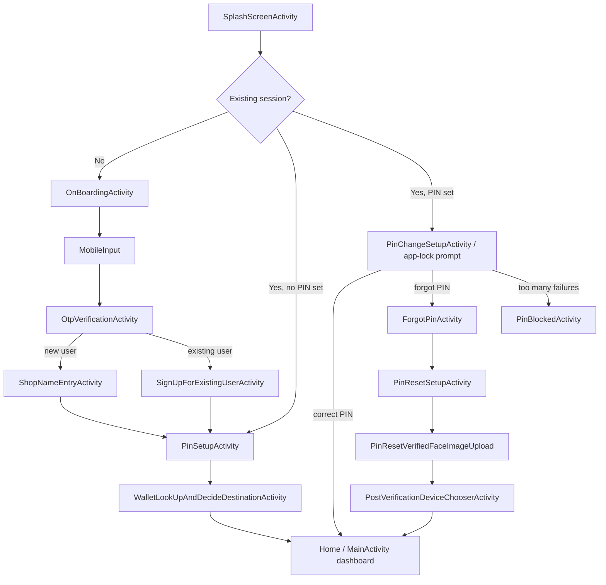
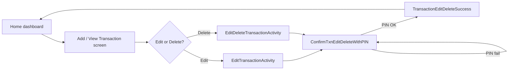
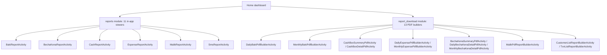
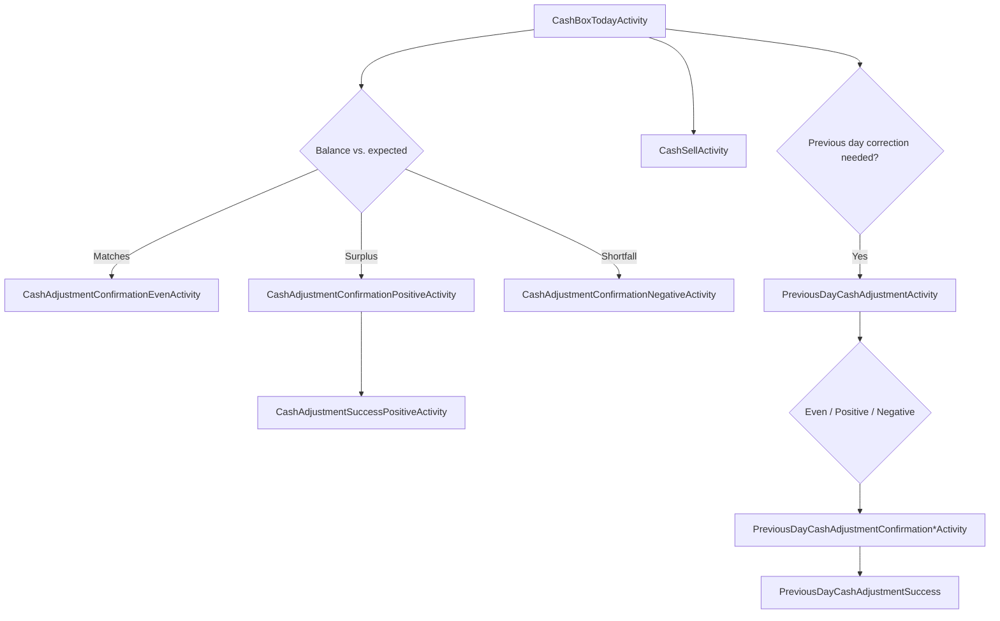
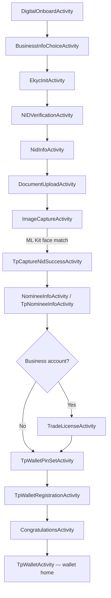
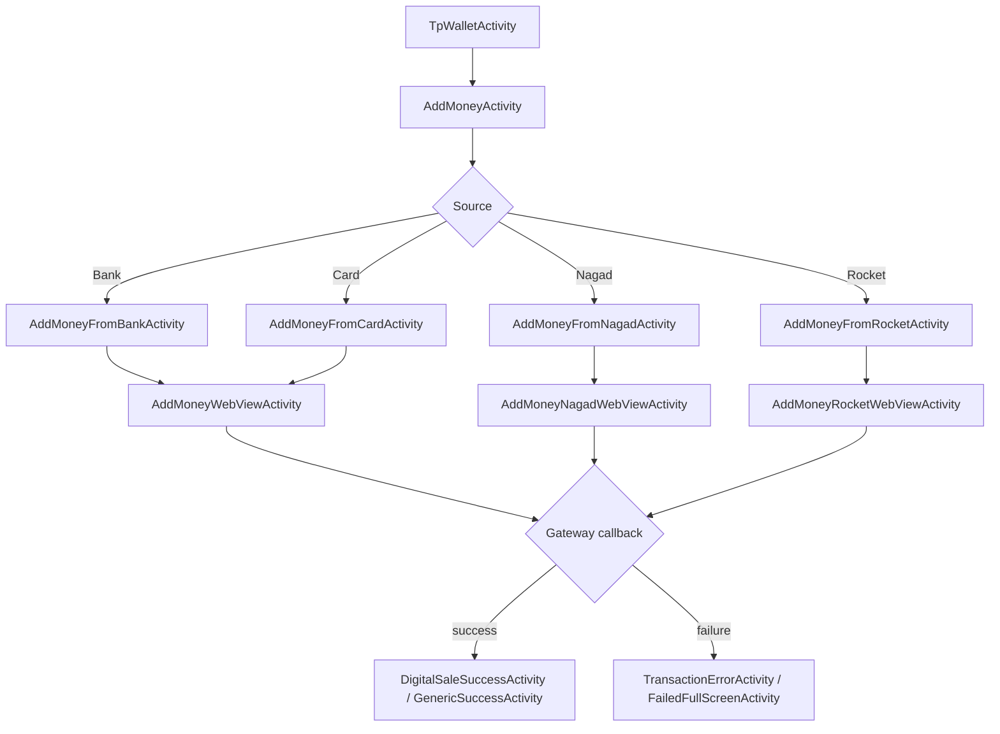
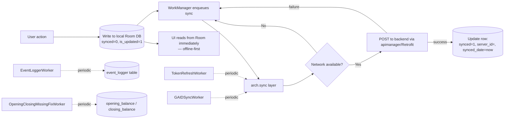

# Phase 5 (cont.) — Application Flow Diagrams

All diagrams below are reconstructed from the **declared Activity graph and naming** (manifest + class inventory) — they show the plausible screen sequence implied by activity names and feature grouping, not a verified runtime navigation graph (which would require either Intent-extra/method-body decompilation or dynamic tracing, neither available here). Treat arrows as "most likely transition," not confirmed `startActivity()` call sites.

## 7.1 App launch → authentication → home

## 7.2 Core ledger ("Khata") transaction + edit/delete-with-PIN pattern
This exact confirm-with-PIN → success pattern recurs identically for 5 different entity types (malik/owner txn, "jer", cash txn, generic transaction, customer/supplier record) — shown once, generalized:

Concrete instances of this pattern in the codebase: `Confirm{Malik,Cash,CashBox}TxnWithPIN`, `ConfirmEditJerWithPIN`, `EditDeleteCustomerConfirmWithPIN` — each with its own `*EditDeleteSuccessActivity` / `*EditDeleteSelectionActivity` pair.

## 7.3 Reporting

## 7.4 Cashbox daily reconciliation

## 7.5 TallyPay — eKYC / wallet onboarding

## 7.6 TallyPay — add money (multi-gateway WebView bridge pattern)

Each WebView bridge activity hosts a provider-hosted checkout page over HTTPS against the Nobopay gateway (`npapigwnew.nobopay.com`, Phase 4) or bKash's bundled asset kit (`assets/bkash/checkout_120.html`), rather than collecting card/bank credentials natively in the app.

## 7.7 Background sync (not a user-facing flow, but completes the architecture picture)

## 7.8 Evidence basis
Derived entirely from `evidence/08_activity_inventory.txt`, `evidence/01_manifest_parsed.json`, `evidence/06_recovered_schema.sql.txt` (for the `synced`/`is_updated`/`server_id` column pattern), and the Worker class list in `02_application_architecture.md §2.4`.
